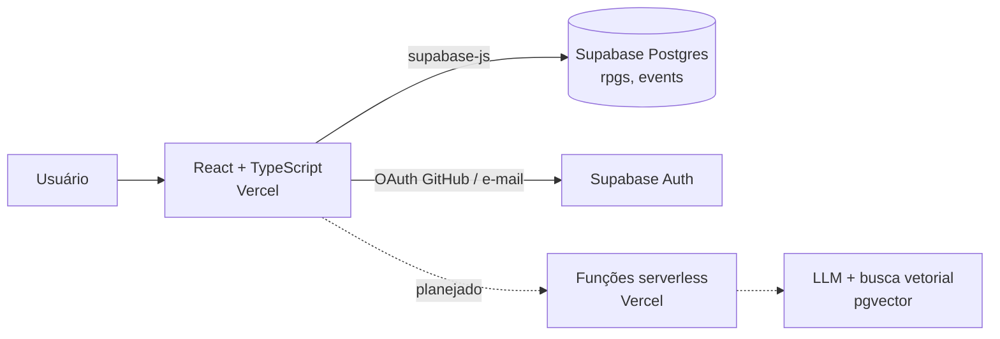
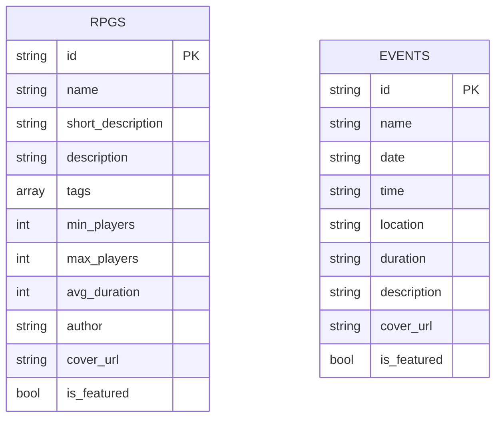

# Encontre RPG

Plataforma que conecta mestres e jogadores a sistemas de RPG independentes e gratuitos, com um catálogo navegável, um quadro de eventos e, em breve, um assistente com IA que recomenda o sistema certo para cada mesa.

<!-- TODO: adicionar o link do site na Vercel e um print ou GIF da home -->


## Contexto e problema

Quem joga RPG de mesa costuma conhecer só os sistemas mais famosos, como D&D. Existem centenas de sistemas independentes, muitos gratuitos, mas a informação sobre eles está espalhada em fóruns, lojas como o itch.io e redes sociais. Isso gera dois problemas:

- **Para jogadores e mestres:** é difícil descobrir um sistema que combine com o estilo do grupo (terror, narrativo, one-shot, solo, número de jogadores, duração da sessão).
- **Para autores independentes:** seus sistemas não chegam a quem procuraria por eles.

O Encontre RPG reúne esses sistemas em um catálogo com tags e informações comparáveis, e divulga eventos onde é possível experimentá-los.

## Público e stakeholders

| Perfil | Necessidade | Como a plataforma atende |
| --- | --- | --- |
| Jogador curioso | Descobrir sistemas diferentes do que já conhece | Catálogo com tags, destaques e descrições curtas |
| Mestre de jogo | Escolher um sistema para o seu grupo e divulgar mesas | Informações de jogadores e duração; quadro de eventos (submissão planejada) |
| Autor independente | Visibilidade para o seu sistema | Página do sistema no catálogo com autoria |
| Moderação | Garantir a qualidade do que é publicado | Fluxo de aprovação de eventos (planejado) |

## Funcionalidades

| Funcionalidade | Status |
| --- | --- |
| Catálogo de RPGs com cards, tags, destaques e informações de jogadores e duração | Pronto |
| Página de eventos com carrossel de destaques | Pronto |
| Dados de catálogo e eventos vindos do Supabase (Postgres) | Pronto |
| Login com GitHub (OAuth) e com e-mail e senha, com saudação na barra de navegação | Pronto |
| Página Sobre com a equipe do projeto | Pronto |
| Filtro do catálogo por tags | Planejado (tags já aparecem na barra lateral) |
| Submissão de eventos por usuários com moderação | Planejado |
| Chatbot que recomenda sistemas usando RAG | Planejado |
| Comparação lado a lado entre dois sistemas e exemplos de fichas | Planejado |
| Favoritos para usuários logados | Planejado |

## Requisitos

### Histórias de usuário

- **HU01.** Como jogador, quero ver um catálogo de sistemas com tags para descobrir opções que combinem com o meu estilo.
  - Cada card mostra nome, descrição curta, tags, número de jogadores e duração média.
- **HU02.** Como jogador, quero ver os próximos eventos para experimentar um sistema novo com outras pessoas.
  - Cada evento mostra nome, data, horário, local, duração e descrição.
- **HU03.** Como mestre, quero entrar com a minha conta do GitHub para não precisar criar mais uma senha.
- **HU04.** Como mestre, quero anunciar uma mesa e saber quando ela foi aprovada. *(planejado)*
- **HU05.** Como jogador indeciso, quero descrever o que procuro e receber sugestões de sistemas do catálogo. *(planejado)*

### Regras de negócio

- **RN01.** Um evento enviado por usuário só fica público depois de aprovado pela moderação. *(planejado)*
- **RN02.** Só usuários autenticados podem enviar eventos ou salvar favoritos. *(planejado)*
- **RN03.** O chatbot recomenda apenas sistemas que existem no catálogo e diz quando nenhum serve. *(planejado)*

### Requisitos não funcionais

- **RNF01.** Interface responsiva, com barra lateral visível apenas em telas grandes.
- **RNF02.** Chaves secretas nunca ficam no frontend: o cliente usa apenas a chave pública (`anon`) do Supabase.
- **RNF03.** Deploy contínuo: cada push na branch principal publica uma nova versão na Vercel.

## Arquitetura



O frontend busca os dados diretamente no Supabase por meio de hooks (`useRpgs`, `useEventos`). A sessão do usuário fica em um contexto React (`LoginContext`), disponível para toda a aplicação.

### Modelo de dados



Os campos seguem os tipos definidos em `client/src/types`. A ligação entre eventos e sistemas, e entre eventos e usuários, faz parte da próxima fase.

## Como rodar localmente

Pré-requisitos: Node.js 20 ou superior e um projeto no [Supabase](https://supabase.com) com as tabelas `rpgs` e `events`.

```bash
git clone https://github.com/vaz-lucas/encontre-rpg.git
cd encontre-rpg/client
npm install
```

Crie o arquivo `client/.env` com as chaves públicas do seu projeto Supabase:

```bash
VITE_SUPABASE_URL=https://seu-projeto.supabase.co
VITE_SUPABASE_ANON_KEY=sua-chave-anon
```

Depois, rode:

```bash
npm run dev      # ambiente de desenvolvimento em http://localhost:5173
npm run build    # checagem de tipos e build de produção
npm run lint     # ESLint
```

Para o login com GitHub funcionar, habilite o provedor GitHub em *Authentication > Providers* no painel do Supabase.

## Estrutura de pastas

```text
client/src
├── pages/       # Home, Catálogo, Eventos, Sobre e Login
├── components/  # Navbar, Sidebar, cards, carrossel, formulário de login
├── hooks/       # useRpgs, useEventos, useAuth
├── context/     # LoginContext: sessão do usuário para toda a aplicação
├── lib/         # cliente do Supabase
├── types/       # interfaces Rpg, Evento e Pessoa
└── data/        # tags, links e dados de exemplo usados antes do banco
```

## Decisões

| Decisão | Alternativas | Por quê |
| --- | --- | --- |
| Supabase para banco e autenticação | Backend próprio em Node + Postgres | Entrega banco, login social e regras de acesso por linha sem manter servidor; libera tempo para o produto. |
| Construir a interface com dados falsos antes do banco | Começar pelo backend | Validou navegação e layout cedo; os tipos criados para os dados falsos viraram o contrato com o banco. |
| Login com GitHub | Só e-mail e senha | Público técnico já tem conta no GitHub; menos atrito e nenhuma senha para guardar. |
| Recomendação com RAG em vez de só um LLM | LLM sem contexto | Um modelo genérico não conhece sistemas independentes pequenos; o RAG faz ele responder com base no catálogo. |
| Tailwind CSS | CSS puro, bibliotecas de componentes | Agilidade para montar um visual próprio e responsivo. |

## Roteiro

O planejamento completo, fase a fase, está em [`client/roadmap-rpg-finder.md`](client/roadmap-rpg-finder.md). Resumo:

- [x] Fase 0: setup, Tailwind e deploy na Vercel
- [x] Fase 1: interface com dados falsos
- [x] Fase 2: catálogo e eventos vindos do Supabase
- [ ] Fase 3: autenticação completa, submissão e moderação de eventos *(login pronto)*
- [ ] Fase 4: funções serverless e API externa
- [ ] Fase 5: chatbot com LLM
- [ ] Fase 6: RAG com pgvector
- [ ] Fase 7: testes, SEO e acessibilidade

## Autor

Desenvolvido por [Lucas Vaz](https://github.com/vaz-lucas).
