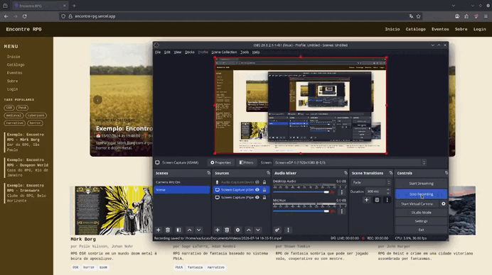

# Encontre RPG

Conectamos jogadores e mestres de RPG a sistemas independentes e gratuitos, com um catálogo navegável e um quadro de eventos para experimentar sistemas novos com outras pessoas.

**Site:** [encontre-rpg.vercel.app](https://encontre-rpg.vercel.app/)

## Contexto

Existem centenas de sistemas de RPG independentes, muitos gratuitos, mas a informação sobre eles está espalhada em fóruns, lojas como o itch.io e redes sociais. Por isso, jogadores acabam presos aos sistemas mais famosos, mestres têm dificuldade de reunir um grupo para testar algo novo, e autores independentes não chegam a quem procuraria por eles.

O Encontre RPG reúne esses sistemas num catálogo com tags comparáveis (gênero, número de jogadores, duração) e divulga eventos onde é possível jogá-los.

## Status atual

| Funcionalidade                                                   | Status    |
| ---------------------------------------------------------------- | --------- |
| Catálogo de RPGs com tags, número de jogadores e duração         | Pronto    |
| Página de eventos com destaques                                  | Pronto    |
| Login com GitHub e com e-mail                                    | Pronto    |
| Mestre publica evento, que fica pendente até a moderação aprovar | Planejado |
| Jogador se inscreve num evento                                   | Planejado |
| Chatbot que recomenda sistemas do catálogo (RAG)                 | Planejado |

## Stack

React, TypeScript, Vite, Tailwind CSS, Supabase (Postgres + Auth), Vercel

## Decisões

| Decisão                                   | Por quê                                                                                                       |
| ----------------------------------------- | ------------------------------------------------------------------------------------------------------------- |
| Supabase em vez de backend próprio        | Entrega banco, login social e regras de acesso sem manter servidor, e libera tempo para o produto.            |
| Interface com dados falsos antes do banco | Validou navegação e layout cedo; os tipos criados viraram o contrato com o banco.                             |
| RAG em vez de só um LLM                   | Um modelo genérico não conhece sistemas independentes pequenos; o RAG faz ele responder com base no catálogo. |

## Catálogo de RPGs com chatbot para auxílio

Exibição de um catálogo de RPGs com suas tags e um chatbot que através de uma conversa auxiliará quem precisa a encontrar um sistema de RPG que se enquadre nas características necessárias.

- Uso de RAG (Retrieval Augmented Generation) para entrega de resultado mais apurado.

## Quadro de anúncios - sistema de login

Mestres poderão anunciar mesas de RPG no site, apenas precisarão criar uma conta (login via Supabase Auth) e preencher um formulário que irá ser verificado pela moderação, permitindo assim um quadro de anúncios que exibirá os eventos recentes.

- Sistema de comentários dos usuários;
- Postagem de fotos dos eventos;

## Comparação de sistemas de RPG

Pode acontecer de haver dúvidas entre quais sistemas utilizar, então o caminho seria permitir maior visualização das vantagens e desvantagens de cada RPG. Para isso será feito:

### Comparação de RPGs lado-a-lado

Página onde a comparação será direta entre 2 RPGs diferentes escolhidos pelo usuário. Sem necessidade de login até o momento.

### Exemplos de fichas de RPG

Demonstrativo de como ficaria a ficha de RPG após a criação de personagem, já que muito é possível saber de acordo com o estilo escolhido pelo autor.

### Favoritos para usuários

E para aqueles que criarem a conta, poderão salvar os favoritos para testar mais tarde.

## Possibilidades de adição futura

- Jogadores poderem fazer inputs de informação para sistemas de RPG que já tiverem testado.
